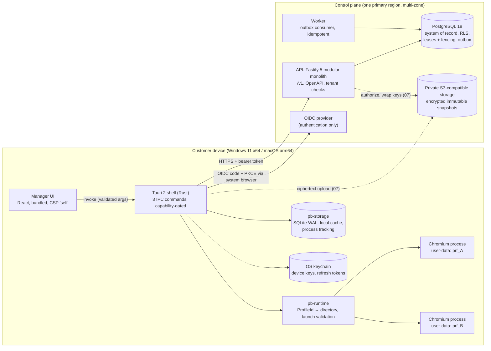

# Architecture (milestone 01 baseline)

## Boundaries that every milestone keeps
- **Untrusted browsing never runs in the manager webview.** Websites load only in separate Chromium processes. The webview can call exactly `list_profiles`, `create_local_profile` and `launch_profile`.
- **Profile directories are derived only from the opaque id**, validated in Rust and in the IPC deserializer. Labels and folders are display text.
- **The server is the authority** for membership, permissions, leases and entitlements. SQLite on the device is a cache and is never consulted for authorization.
- **Leases use the database clock** and a monotonically increasing fencing token; any write that depends on holding a profile presents the token.
- **Every state change and its event commit together** (transactional outbox); consumers deduplicate on `event_id`.
- **Isolation claim is limited to stored data.** Separate directories do not change device or network signals (roadmap release boundary).

## Data ownership
| Store | Holds | Authority? |
|---|---|---|
| PostgreSQL | organizations, users, memberships, devices, profile metadata, leases, snapshot manifests, idempotency keys, outbox, audit index, entitlements | Yes |
| SQLite (device) | local profile metadata, process tracking, queued local-only changes | No |
| Object storage | encrypted immutable snapshots, addressed by server-generated keys | Contents only; access authorized by API |
| OS keychain | device-wrapped keys, refresh credentials | Device secrets only |

## Code map
| Path | Role |
|---|---|
| `packages/contracts` | ids, error envelope, pagination, events, resource schemas, permission matrix |
| `packages/config` | environment schema and staging/prod safety checks |
| `packages/ui` | design tokens, accessible focus, client badge |
| `services/api` | Fastify API, auth, tenancy, idempotency, outbox writer, migrations runner, fixtures |
| `services/worker` | outbox consumer (audit index), maintenance |
| `crates/runtime` | `ProfileId`, directory layout, launch validation, process launcher |
| `crates/storage` | SQLite WAL store |
| `crates/update` | pinned runtime manifest and artifact hash verification |
| `crates/import` | profile configuration import/export: CSV/JSON/bundle parsing, row validation, archive safety, notes hygiene (milestone 04) |
| `apps/desktop` | Tauri shell + React manager UI |
| `apps/web-admin` | admin console shell |
| `infra` | migrations, local bootstrap, env examples, docker-compose |
| `spikes` | step 4 and step 6 feasibility harnesses |
