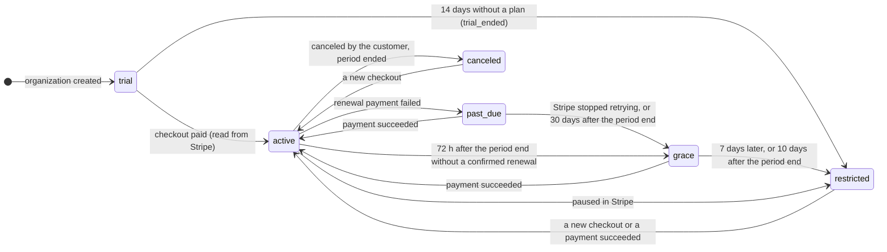

# Billing, plan limits and support (milestone 11)

Decisions and their reasons: [ADR-0018](../adr/0018-billing-plan-limits-and-support-access.md). This page is the
working reference: the state diagram, how the plan catalog is configured, what the reconciliation worker does, the
support roles, the settings, and how to run Stripe in test mode on the test server. The
[cost worksheet](cost-worksheet.md) is where prices and limits get decided.

Merchant: **Ten Tech Solutions LLC** (Wyoming, United States), Stripe, USD. Prices, final limits, the retention
policy after cancellation and tax registrations are the owner's decisions; nothing in the code assumes them.

## Billing states



| State | Access | What the owner sees | Leaves when |
|---|---|---|---|
| `trial` | Everything within the trial plan's limits | Days left and "choose a plan" | A paid checkout (→ active) or day 14 (→ restricted) |
| `active` | Everything within the plan's limits | Renewal date | A failed renewal, a cancellation that takes effect, a missing renewal |
| `past_due` | Everything | Banner: update the payment method (Stripe retries on its schedule) | Payment succeeds, or Stripe gives up, or 30 days after the period end (→ grace, whatever Stripe's retry setting) |
| `grace` | Everything for 7 days | Banner with the end date: last warning | Payment succeeds, or the 7 days end (→ restricted) |
| `restricted` | Read, close, back up, export, delete, billing | What still works; nothing is deleted | A paid checkout or a successful payment |
| `canceled` | Same as restricted | Same, "canceled" | A new checkout |

`restricted` and `canceled` refuse only these actions (`RESTRICTED_ACTIONS` in
[`packages/contracts/src/billing.ts`](../../packages/contracts/src/billing.ts)), with `SUBSCRIPTION_RESTRICTED`
(403): creating profiles, clients, invitations, API tokens, webhook endpoints and jobs; opening profiles; computers
claiming jobs; imports; restoring from the trash; joining through an invitation made earlier. Closing a profile, its closing backup, downloading and restoring
backups, exporting, deleting and billing always keep working. **No billing state deletes anything.**

Time-based changes (trial end, grace end, an unconfirmed renewal, a payment failing for 30 days) take effect at the moment of the request:
`app.billing_effective(org)` computes the state from the stored state, the dates, active overrides and the clock. The
worker only records them afterwards (history, the organization's activity log).

How Stripe's subscription status maps: `trialing`→trial, `active`→active, `past_due`→past_due, `unpaid`→grace,
`canceled` because the customer asked→canceled, other `canceled`→grace, `paused`→restricted,
`incomplete`/`incomplete_expired`→ignored (an unfinished checkout changes nothing).

## Plan catalog

The catalog is code: `PLAN_CATALOG` in [`packages/contracts/src/billing.ts`](../../packages/contracts/src/billing.ts).
Each plan is `id@version` with four limits (`null` = no limit) and four features. The migration script copies it into
the `plans` table and **stops if a released `id@version` was changed** — a change is a new version.

| Plan | Sold | Seats | Profiles | Backup storage | Automation at a time | Shared profiles | Automation, API tokens, webhooks |
|---|---|---|---|---|---|---|---|
| `trial@1` | — (14 days, every new organization) | 5 | 100 | 10 GiB | 2 | yes | yes |
| `starter@1` | yes | 1 | 100 | 10 GiB | 1 | no | yes |
| `team@1` | yes | 5 | 500 | 50 GiB | 5 | yes | yes |
| `agency@1` | yes | 20 | 2,000 | 200 GiB | 20 | yes | yes |
| `beta@1` | no (organizations from before milestone 11) | 10 | 500 | 20 GiB | 5 | yes | yes |
| `internal@1` | no (staff, fixtures) | — | — | — | — | yes | yes |

**These limits are provisional placeholders.** Set the real ones from the [cost worksheet](cost-worksheet.md) and pilot
feedback.

Changing the catalog:
1. Add a new version (e.g. `team@2`) next to the old one; never edit a released version. Mark the old one
   `purchasable: false` if it should no longer be sold. Organizations keep the version they bought until they change
   plans in the portal (grandfathering).
2. Create its Stripe price (`stripe-setup.ts` below, or the Stripe Dashboard) and map it in `BILLING_STRIPE_PRICES`
   (`{"team@2":"price_…"}`). A plan without a price is shown but cannot be bought ("not offered on this server yet").
3. Deploy: the migration step syncs the catalog.

Prices exist only in Stripe. Plan changes, payment methods, invoices and cancellation happen in Stripe's hosted
customer portal; `stripe-setup.ts` creates a portal configuration that offers exactly the configured prices and
cancels at the end of the period.

## Limits under concurrency

Database triggers lock the organization's `subscriptions` row and count before each new profile (including imports
and restores from the trash), member and invitation; above the limit they refuse with `PLAN_LIMIT_REACHED` (409:
`limit`, `used`, `allowed`, and what to do). Concurrent requests queue on the lock, so they cannot overshoot. An
invitation reserves its seat when it is sent; accepting it is refused while the organization is over its seats (after
a downgrade: upgrade or withdraw invitations first) or restricted. Storage is the plan's (with overrides), under the
service operator's ceiling per organization (`organizations.backup_quota_bytes`, 1 TiB by default). Job claims use the smaller of the organization's
running limit and the plan's. A downgrade never removes anything: what is over the new limit stays usable, only new
creation stops.

## Settings

| Variable | Where | Meaning |
|---|---|---|
| `STRIPE_SECRET_KEY` | API, worker | `sk_test_…`/`rk_test_…` (any `APP_ENV` but `prod`) or `sk_live_…`/`rk_live_…` (only `prod`). Without it billing routes answer `BILLING_UNAVAILABLE` and everything else works |
| `STRIPE_WEBHOOK_SECRETS` | API, worker | Required with a key: endpoint signing secrets (`whsec_…`), comma-separated during a rotation |
| `BILLING_STRIPE_PRICES` | API, worker | JSON `{"plan@version":"price_…"}` |
| `STRIPE_PORTAL_CONFIGURATION` | API | Optional customer portal configuration (`bpc_…`); default: the account's default |
| `BILLING_RETURN_URL` | API | Where checkout and the portal send people back (an informational page; never proof of payment). Default `http://127.0.0.1:8080/v1/billing/return` |
| `BILLING_AUTOMATIC_TAX` | API | `true` asks Stripe Tax to calculate tax — only after the tax registrations exist in Stripe |
| `BILLING_RETENTION_DAYS` | API | The owner's retention policy after cancellation (30–3650), shown to owners. Empty: kept until an owner deletes it. Nothing deletes automatically in v1 |
| `STRIPE_API_BASE` | API, worker | Tests only (`dev`/`test`): stripe-mock or a fake |
| `CONSOLE_DIR` | API | The built support console (`apps/web-admin/dist`), served at `/console/` |
| `OIDC_CONSOLE_CLIENT_ID` | API | The support console's own public OIDC client |

On the test server, `vps-setup.sh` writes `CONSOLE_DIR`; your billing settings live in
`/etc/project-browser/billing.env` (created once, never overwritten); the webhook secret comes from the Stripe CLI
forwarder (`stripe-webhook.env`); `keycloak-setup.sh` writes `OIDC_CONSOLE_CLIENT_ID`.

## Webhooks and the reconciliation worker

`POST /v1/webhooks/billing` checks the `Stripe-Signature` against the exact raw body (5-minute tolerance, any of the
configured secrets), refuses a test event on a live key and the reverse, and stores only the event id, type, object id
and time — no payload — under the event id (duplicates answer 200 and do nothing). It answers at once.

The worker (`services/worker`, with `services/api/src/billing/reconcile.ts`):

| When | What |
|---|---|
| Continuously (every half second when idle) | Processes up to 20 pending events: fetches the **current** subscription, checkout session or invoice from Stripe and applies it. Order and duplicates do not matter: a fetch that started before the last applied one is ignored, a live subscription is preferred over an ended one and of two alike the newer, so a replayed or late "paid" read cannot undo a cancellation. Stripe unreachable: retried with backoff; the organization keeps its last state |
| Every 5 minutes | Resyncs subscriptions not confirmed for 24 h, or for 1 h when past due, in grace, or around the period end, and those staff asked for; a failing one backs off (15 minutes, or 6 hours with an alert); checks the event backlog |
| Every minute | Records time-based transitions in the history and the organization's activity log |
| Every hour | Samples usage (storage, active profiles, seats) into the ledger |

Reconciliation alerts (support console → Alerts; one open alert per kind and reference, with a count):

| Alert | Means | Usually |
|---|---|---|
| Provider events waiting (`webhook_backlog`) | Events waiting over 30 minutes | Stripe or the worker is down; check `journalctl -u pb-worker` |
| Provider event failing (`event_failed`) | An event keeps failing | Read the error; the worker keeps retrying |
| Unknown customer / Unknown price | An event for a customer or price this server does not know | Another system uses the same Stripe account, or `BILLING_STRIPE_PRICES` misses a price |
| Duplicate subscriptions | A customer has two live subscriptions | Cancel one in Stripe; refund if needed |
| Paid but not active (`paid_not_active`) | A paid invoice while the organization is not active | Resync from the console; check the subscription in Stripe |
| Missed provider event (`missed_webhook`) | A resync changed the state: an event did not arrive | Check webhook delivery (or the forwarder on the test server) |
| Refund / Payment dispute | Money moved back | Decide whether the plan should change; nothing is deleted |
| Signature failures | Requests with bad signatures | A wrong or rotated secret, or someone probing the endpoint |
| Resync failing (`resync_failed`) | Stripe keeps refusing the resync of one organization (its resyncs back off for 6 hours) | The stored customer or subscription no longer exists in this Stripe mode; fix it in Stripe, then "Confirm with Stripe now" |

Invoices are mirrored from Stripe (number, status, amounts, currency, hosted links) for the owner's invoice list; the
desktop opens the hosted invoice or PDF in the default browser.

The usage ledger (`usage_events`, unique per organization and `dedupe_key`) records committed snapshots, finished jobs,
daily storage/profiles/seats samples and daily API-token requests; reprocessing never counts twice. Nothing is billed
from it in v1; it feeds the usage screen and the cost worksheet.

## Support console and roles

The internal console (`apps/web-admin`) is served by the API at `/console/` and signs staff in with its own OIDC
client (PKCE). Staff tokens last 30 minutes, cannot be refreshed and work only on `/v1/support/*`; organization
sign-ins never work there. Staff roles are not organization roles and no API can grant them.

| Role | Can |
|---|---|
| `support` | Find an organization by id, Stripe customer id or exact e-mail; see its billing overview (plan, state, dates, limits and usage numbers, invoices, Stripe events, history, alerts); request time-bound access to members or the activity log |
| `support_lead` | The above, plus approve or deny **other** people's access requests (never their own), see all requests, alerts and the platform audit |
| `billing_admin` | The overview, plus entitlement overrides (reason ≥ 20 characters, ends within 90 days, revocable), "confirm with Stripe now" (resync), resolving alerts, alerts and the platform audit |

Every search, view, request, decision and override is in the platform audit; access approvals, member/activity views
and overrides also appear in the **organization's own activity log**. Browser session data is not reachable from the
console at all.

Managing staff (on the server; the person signs in once first, e.g. on the console, so the account exists):

```bash
runuser -u pb -- bash -c "cd /home/pb/antibrowser/services/api && \
  /opt/node/bin/node --env-file=/etc/project-browser/api.env scripts/staff.ts add you@example.com --roles support_lead,billing_admin"
runuser -u pb -- bash -c "cd /home/pb/antibrowser/services/api && \
  /opt/node/bin/node --env-file=/etc/project-browser/api.env scripts/staff.ts list"
runuser -u pb -- bash -c "cd /home/pb/antibrowser/services/api && \
  /opt/node/bin/node --env-file=/etc/project-browser/api.env scripts/staff.ts remove someone@example.com"
```

Two different people are needed for sensitive access: one with `support` (or any role) asks, a different
`support_lead` approves.

## Stripe test mode on the test server

The test server is reachable only through the SSH tunnel, so Stripe cannot call its webhook address. Instead
`vps-setup.sh` runs the Stripe CLI as a forwarder (`pb-stripe-listen`, its own user, version pinned and checksum
verified): it opens an outbound connection to Stripe and passes test-mode events to the API. Live keys are refused on
this server.

1. Update the server: run the update command **twice** (the first run copies the new script), then
   `\cp -f /home/pb/antibrowser/scripts/deploy/keycloak-setup.sh /root/ && bash /root/keycloak-setup.sh` once (it adds
   the console's sign-in client).
2. In the Stripe Dashboard switch on **Test mode** → Developers → API keys → copy the secret key. On the server:
   `nano /etc/project-browser/billing.env` and put it after `STRIPE_SECRET_KEY=`. Do not paste it anywhere else.
3. Create the products, prices and portal configuration with **your** amounts (dollars), as root:
   ```bash
   /opt/node/bin/node --env-file=/etc/project-browser/billing.env \
     /home/pb/antibrowser/services/api/scripts/stripe-setup.ts \
     --price starter=AMOUNT --price team=AMOUNT --price agency=AMOUNT --write /etc/project-browser/billing.env
   ```
   Re-running is safe; a changed amount makes a new Stripe price (prices are immutable).
4. Run the update command once more: it installs the forwarder, reads its signing secret and restarts the services
   ("Stripe events forwarder connected").
5. In the desktop app: Organization → Billing → Choose a plan. Stripe's checkout opens in your browser; use Stripe's
   test card `4242 4242 4242 4242` with any future date and any CVC. The app shows the plan within seconds.
6. Support console: open `http://127.0.0.1:8080/console/` through the tunnel, sign in once (it says the account is
   not staff), add your roles with `staff.ts add`, sign in again.

## Before charging real customers (milestones 12 and 14)

- A public HTTPS address for the API and a Stripe webhook endpoint (Dashboard → Developers → Webhooks) on API version
  `2025-03-31.basil` with the events in `HANDLED` (`services/api/src/routes/billing.ts`); its secret in
  `STRIPE_WEBHOOK_SECRETS`; live keys only with `APP_ENV=prod`.
- Final prices and limits (a new catalog version), the retention policy and terms of service, tax registrations in
  Stripe (and `BILLING_AUTOMATIC_TAX=true` if Stripe Tax is used), Stripe's statement descriptor and support details.
- The live setup is a reviewed step; `stripe-setup.ts` refuses live keys on purpose.

## Failure handling

| Requirement | How |
|---|---|
| A Stripe outage must not lock paid users out | Access is decided from the database only; an `active` organization stays active, and only 72 h after its period end without a confirmed renewal is it treated as grace (10 days before restricted); `past_due` ends after 30 days the same way |
| Never two paid subscriptions | A new checkout expires the customer's earlier open checkout and is refused while Stripe has a live subscription (even one the worker has not applied yet); duplicates that still happen raise an alert |
| An unavailable billing service never overrides tenant permissions | Billing only narrows what roles and grants allow; requests never call Stripe to decide access |
| A replayed paid event cannot reactivate a newer canceled state | Events are applied from the current Stripe object; a fetch older than the last applied one is ignored; an ended subscription never replaces a live one |
| Refunds and reversals reconcile, never delete | Recorded with an alert; nothing is deleted |
| No card data in logs | Hosted checkout and portal only; webhook payloads are not stored or logged; tests scan the logs |

## Tests

- `services/api/test/billing.test.ts` — lifecycle, webhooks (signature, duplicates, order, replay after cancellation),
  upgrade, downgrade, cancellation, trial and grace expiry, outages, concurrent profile and seat creation, restricted
  organizations closing and exporting, logs without card data; against an in-process fake Stripe.
- `services/api/test/support.test.ts` — staff sign-in, roles, two-person approval, expiry, overrides, audit.
- `services/api/test/stripe-mock.test.ts` — request shapes (client and `stripe-setup.ts`) against Stripe's OpenAPI via
  stripe-mock (CI).
- `services/api/test/stripe-sandbox.test.ts` — Stripe test mode with a test clock (CI, when the repository secret
  `STRIPE_TEST_SECRET_KEY` exists).
- `services/api/test/console.test.ts`, `keycloak.test.ts` — console page and its sign-in client.
- `apps/desktop/e2e` (billing screen) and `apps/web-admin/e2e` (console), with axe in light and dark.
